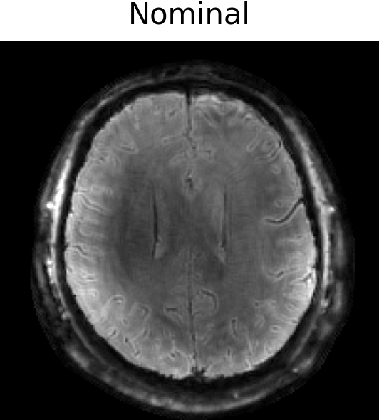
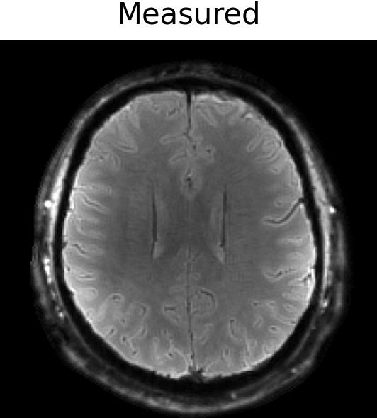
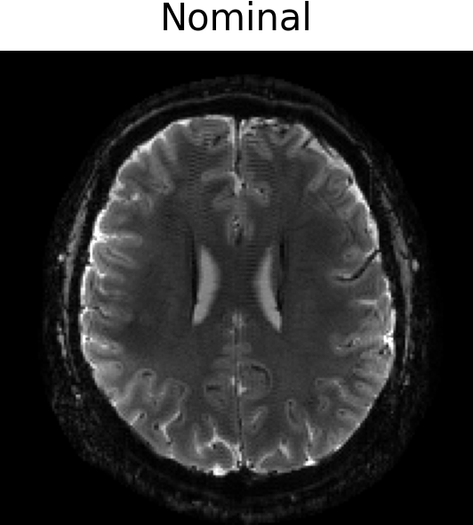

# HighOrderMRI.jl

[](https://github.com/BennyZhang-Codes/HighOrderMRI.jl/actions/workflows/ci.yml)
[](https://github.com/BennyZhang-Codes/HighOrderMRI.jl/actions/workflows/documentation.yml?query=branch%3Adocs)
[](https://bennyzhang-codes.github.io/HighOrderMRI.jl/dev/)

HighOrderMRI.jl is a Julia toolbox for Cartesian and non-Cartesian MRI reconstruction with measured or predicted dynamic higher-order fields. It provides explicit encoding operators for numerical reference, fused CUDA implementations, and a matrix-free shared-subspace operator for large 2D and 3D reconstruction.

## Features

- Expanded signal encoding through third-order real solid-harmonic terms.
- Parallel imaging, static off-resonance correction, and reconstruction masks.
- `HighOrderOp`: array-based explicit evaluation on CPU or CUDA.
- `HighOrderKernelOp`: fused explicit CUDA evaluation on one or more GPUs.
- `HighOrderLowRankOp`: per-dynamic matrix-free rSVD, adaptive incremental shared spatial basis, and a global-trajectory NFFT.
- Optional voxel distribution for multi-GPU rSVD setup and channel, rank, or readout distribution for reconstruction.
- GIRF-based field prediction and model-based field/data synchronization ([Dubovan and Baron, 2023](https://doi.org/10.1002/mrm.29460)).
- Raw complex reconstruction metrics, encoding-convention regression tests, and a documented scientific validation strategy.

## Documentation

The current development documentation is available at [HighOrderMRI.jl/dev](https://bennyzhang-codes.github.io/HighOrderMRI.jl/dev/). The `docs` branch builds VitePress and deploys a complete Pages artifact directly through GitHub Actions. The site publishes `/dev/`, `/stable/`, and each version listed in `docs/versions.json`. The root URL opens stable. Development follows a pinned main commit. Each formal version pins its code commit, page content, figures and API mapping. The shared site theme supplies the version menu. Source docstrings supply the API reference, with interface and CPU example checks on the code branch.

This branch contains the website in `docs/` and its build configuration. Package source, tests and demo data are maintained on the code branches. To preview the website, prepare a separate code checkout with its Julia dependencies, then run from this checkout:

```bash
npm ci --prefix docs
export DOCS_CODE_PATH=/absolute/path/to/HighOrderMRI-code
npm run docs:build-site --prefix docs -- --preview
npm run docs:preview --prefix docs
```

See [local documentation builds](https://bennyzhang-codes.github.io/HighOrderMRI.jl/dev/getting-started#build-the-documentation-locally) for prerequisites. Complete-site candidate builds use exact clean code checkouts too. `docs/code-version.json` pins dev. `docs/versions.json` records release code and documentation commits and the newest stable version. Set `DOCS_CODE_ROOT` to a directory containing one checkout per full code SHA when versions use different code commits. Formal builds omit `--preview` and require matching version tags. CI also verifies published, non-prerelease GitHub Releases. See `docs/RELEASING.md` for the release procedure.

The documentation contains:

- installation and a first CPU example;
- the expanded signal model, units, basis order, and NFFT convention;
- the randomized SVD and incremental shared spatial-subspace derivation;
- operator selection, reconstruction, multi-GPU, and synchronization guides;
- a scientific validation strategy separating implementation consistency, low-rank approximation, independent numerical validation, and physical validation;
- reconstruction conventions, performance reporting guidance, API reference, references, and troubleshooting.

## Installation

HighOrderMRI.jl requires Julia 1.12 or later. CI tests both the minimum supported Julia 1.12 release and the latest stable Julia 1.x release; the documentation checks use Julia 1.12. The package includes `MRIGeometry` as a local subpackage. Install it from a separate clone of the `main` code branch:

```bash
git clone --branch main https://github.com/BennyZhang-Codes/HighOrderMRI.jl.git HighOrderMRI-code
cd HighOrderMRI-code
julia --project=. -e 'using Pkg; Pkg.instantiate()'
```

Then start Julia with the project and load the package:

```julia
using HighOrderMRI
```

CUDA execution additionally requires a functional [CUDA.jl](https://github.com/JuliaGPU/CUDA.jl) installation. Start Julia with `--threads=auto` when multiple GPUs participate.

## Demo

For MRI reconstruction incorporating measured field dynamics, we first estimate the synchronization delay between the MRI data and the field measurements. The final reconstruction is then performed using the synchronized field dynamics.

The current demo data include 2D single-shot spiral (7 T, 1 mm in-plane resolution, approximately 29 ms readout) and 2D single-shot EPI (7 T, 1 mm in-plane resolution, approximately 40 ms readout) examples. These datasets demonstrate the workflow but do not define the scope of the reconstruction framework, which supports Cartesian and non-Cartesian 2D/3D encoding models. The demo compares a nominal k-space trajectory with field dynamics measured using a Dynamic Field Camera.

<table>
  <tr>
    <th colspan="4" style="text-align:center">2D Spiral (left) & 2D EPI (right)</th>
  </tr>
  <tr>
    <td></td>
    <td></td>
    <td></td>
    <td></td>
  </tr>
</table>

## Scientific validation

Agreement between `HighOrderOp` and `HighOrderKernelOp` establishes consistency between two implementations of the same explicit model. `HighOrderLowRankOp` should additionally be evaluated against a frozen explicit reference, and absolute encoding claims require an independent numerical or physical reference. See the [scientific validation strategy](https://bennyzhang-codes.github.io/HighOrderMRI.jl/dev/guide/validation) and [reconstruction protocol](https://bennyzhang-codes.github.io/HighOrderMRI.jl/dev/guide/reconstruction-protocol) before reporting accuracy or performance.

## Copyright & License Notice

This software is copyrighted by the Regents of the University of Minnesota and the Institute of Biophysics, Chinese Academy of Sciences. It can be freely used for educational and research purposes by non-profit institutions, US government agencies, and Chinese government agencies only.
Other organizations are allowed to use this software only for evaluation purposes, and any further uses will require prior approval. The software may not be sold or redistributed without prior approval.
One may make copies of the software for their use provided that the copies are not sold or distributed, and are used under the same terms and conditions.
As unestablished research software, this code is provided on an "as is'' basis without warranty of any kind, either expressed or implied.
The downloading, or executing any part of this software constitutes an implicit agreement to these terms. These terms and conditions are subject to change at any time without prior notice.
