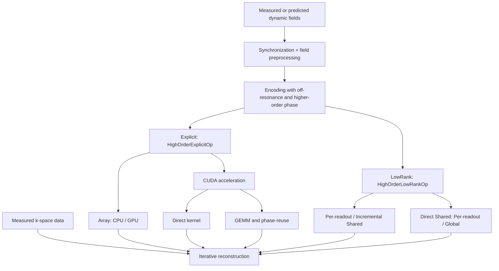

# HighOrderMRI.jl overview

The [algorithm and implementation tree](/guide/operators) separates Explicit
from LowRank and lists their public selectors.

HighOrderMRI.jl reconstructs MRI data with static off-resonance and dynamic
higher-order phase terms. Explicit and LowRank use the same signal model,
with different ways to evaluate its encoding operator.

The two families differ in numerical representation. Explicit selects Array,
Direct kernel or GEMM and phase-reuse; LowRank selects Per-readout, Incremental
Shared or Direct Shared construction. They retain the same target physical
model, with approximation errors assessed separately.

## Core components

### Dynamic field encoding

The encoding model combines Cartesian or non-Cartesian sampling, receive-coil sensitivities, static off-resonance, and spatially varying dynamic field terms. The current high-order encoding constructors support real solid-harmonic terms through third order.

### Explicit implementations

`HighOrderExplicitOp` selects Array or CUDA acceleration, with
Direct kernel and GEMM and phase-reuse in the CUDA acceleration branch. The
selector `implementation=:kernel` retains its existing meaning.
Its Array implementation evaluates the phase with CPU or CUDA array operations.
Its CUDA implementation uses direct kernels or resident matrix backends, with
supported multi-GPU execution. Agreement between these implementations assesses numerical consistency of the software pathways; it is not, by itself, an independent validation of the underlying physical model.

### Low-rank acceleration

`HighOrderLowRankOp` selects independent [Per-readout](/guide/per-readout)
factors, [Incremental Shared](/guide/incremental-shared) (the existing default),
or [Direct Shared](/guide/direct-shared). Direct Shared has Per-readout and
Global strategies, with different coefficient orderings and rank checks.
All approximate residual spatial phase. The NFFT evaluates active x/y Fourier
terms in 2D and x/y/z terms in 3D; `kz*z` remains in the 2D residual. NFFT
approximation error is separate from factor-construction error. The theory
pages distinguish mathematical identities, empirical policies and measured
performance.

### Validation strategy

Validation is organized hierarchically. Explicit-implementation agreement, low-rank approximation error, independent numerical validation, and physical validation address distinct questions and should be reported separately. The [scientific validation strategy](/guide/validation) defines these evidence levels, and the [reconstruction protocol](/guide/reconstruction-protocol) specifies the conventions that should remain fixed during controlled comparisons.
