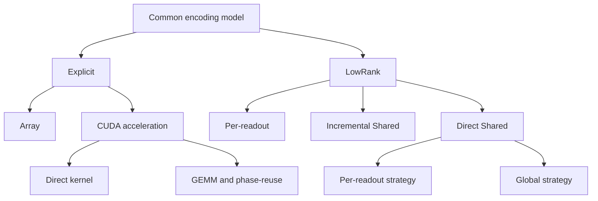

# Encoding algorithms and implementations {#encoding-operators}

Two families implement the same physical signal model: **Explicit** evaluates
the selected phase directly; **LowRank** approximates the residual phase while
retaining the first-order Fourier terms in an NFFT.

| Family | Public entry | Choices |
|:--|:--|:--|
| [Explicit](/guide/explicit) | `HighOrderExplicitOp` | [Array](/guide/explicit-array), CUDA acceleration: [Direct kernel](/guide/explicit-kernel) or [GEMM and phase-reuse](/guide/explicit-gemm) |
| [LowRank](/guide/low-rank) | `HighOrderLowRankOp` | [Per-readout](/guide/per-readout), [Incremental Shared](/guide/incremental-shared), [Direct Shared](/guide/direct-shared) |

Direct Shared has [Per-readout](/guide/direct-shared-per-readout) and
[Global](/guide/direct-shared-global) strategies. These describe shared-basis
construction and rank selection, independently of CUDA scheduling and FFT
execution. The default LowRank method remains Incremental Shared.



## Method selection {#implementations}

```julia
explicit = HighOrderExplicitOp(grid, kspha_matrix, times_vector;
    implementation=:array, arrayType=Array)
incremental = HighOrderLowRankOp(grid, kspha, times;
    method=:incremental_shared, arrayType=Array)
direct = HighOrderLowRankOp(grid, kspha, times;
    method=:direct_shared, strategy=:global, epsilon_H=0.01, arrayType=Array)
```

These are construction patterns; supply the same measured fieldmap, CSM, mask
and full data in a controlled comparison. They are not complete runnable data
examples. The [Explicit API](/reference/highorderexplicitop) and
[LowRank API](/reference/highorderlowrankop) contain complete CPU examples.

Use `HighOrderExplicitOp` for Explicit and `HighOrderLowRankOp` for LowRank.
Explicit selects its implementation with `implementation`; LowRank selects
its construction with `method` and `strategy`. Execution and solver settings
are configured separately.

## Common inputs

For a grid of size `(nX,nY,nZ)`:

- `fieldmap`: `(nX,nY,nZ)`, or `(nX,nY)` when `nZ == 1`;
- `csm`: `(nX,nY,nZ,nCha)`, or `(nX,nY,nCha)` when `nZ == 1`;
- `mask`: the spatial grid shape;
- `k_nominal`: first-order coefficients ordered as `kx`, `ky`, `kz`;
- `recon_terms`: order-selection string defined in the [expanded encoding model](../theory/encoding-model.md#selecting-field-orders);
- `concomitant`: optional integrated coefficients `(4,nSam)` for the explicit/single-dynamic operators or `(4,nSam,nDyn)` for dynamic LowRank, ordered as `z²`, `x²+y²`, `xz`, `yz`. Supply cycles/m² in the grid frame and origin; see [concomitant phase](/theory/encoding-model#optional-concomitant-phase).

The operator column count is always `prod(grid.matrixSize)`. A mask removes background voxels from the encoding calculation, while the adjoint restores unencoded voxels as zeros in the full image vector.

## Coil compression

Both families and their existing concrete operators accept compressed data and compressed CSM through the same interface. Fit one `CoilCompressionTransform` and apply the same right-side transform to the data and sensitivity maps:

```julia
data_cc, csm_cc, transform = compress_coils(
    data,
    csm;
    data_coil_dim=2,
    n_virtual_coils=10,
    noise_covariance,
)

op = HighOrderExplicitOp(grid, kspha, times; csm=csm_cc, arrayType=Array)
image = recon_HOOp(op, data_cc, weights, rec_params)
```

The same `csm_cc` can be supplied to `HighOrderExplicitOp` or `HighOrderLowRankOp`. Using one transform for both acquired signals and coil sensitivities preserves the transformed signal equation; independently fitted transforms generally do not.

For a noise-only matrix with samples in rows and coils in columns, estimate

```julia
noise_covariance = estimate_noise_covariance(noise_data; coil_dim=2)
```

before fitting the transform. Omitting the covariance corresponds to an independent, equal-variance noise model. The whitening and compression equations are given in [Coil compression](/guide/coil-compression).


## Array-based explicit evaluation {#highorderop-array-based-explicit-evaluation}

The former Array section is now [Explicit: Array](/guide/explicit-array).

## Direct kernel {#highorderkernelop-explicit-cuda-evaluation}

The former Kernel section is now [Direct kernel](/guide/explicit-kernel).

## GPU-resident explicit reconstruction

Resident direct execution is described in [Direct kernel](/guide/explicit-kernel);
phase reuse, full caching, weights and memory accounting are in
[GEMM and phase-reuse](/guide/explicit-gemm).

## Shared spatial representation {#highorderlowrankop-shared-spatial-representation}

See [Incremental Shared](/guide/incremental-shared) and
[Direct Shared](/guide/direct-shared) for their different construction paths.

### Independent per-readout factors

See [Per-readout](/guide/per-readout) for local factors, streaming and regeneration.

### Direct shared construction {#automatic-joint-shared-basis}

See [Direct Shared](/guide/direct-shared) for both strategies and fixed-rank controls.

## Implementation paths

`HighOrderExplicitOp` is the Explicit family type and constructor. Its
internal Array and CUDA implementations live in `EncodingOperator/Explicit/`.
`HighOrderLowRankOp` handles construction and products for all LowRank methods;
its factor and execution components live in `EncodingOperator/LowRank/`.
Both families work with `recon_HOOp` and the documented normal and resource
interfaces.

## Numerical consistency checks

Compare random complex forward, adjoint and weighted-normal products against
an independent phase reference. Preserve data, initial image, weights,
normalization, regularization, precision and solver when comparing complete
reconstructions. Use [Scientific validation](/guide/validation) for the full
numerical/physical evidence hierarchy, and [execution](/guide/multi-gpu) and
[resources](/reference/resources) for device scheduling and cleanup.
